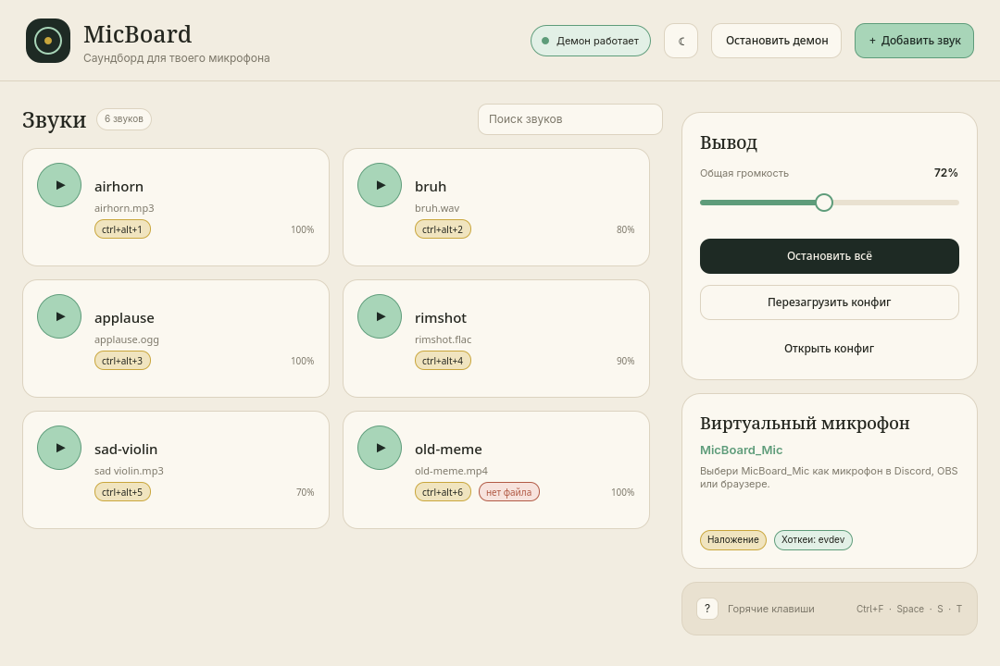
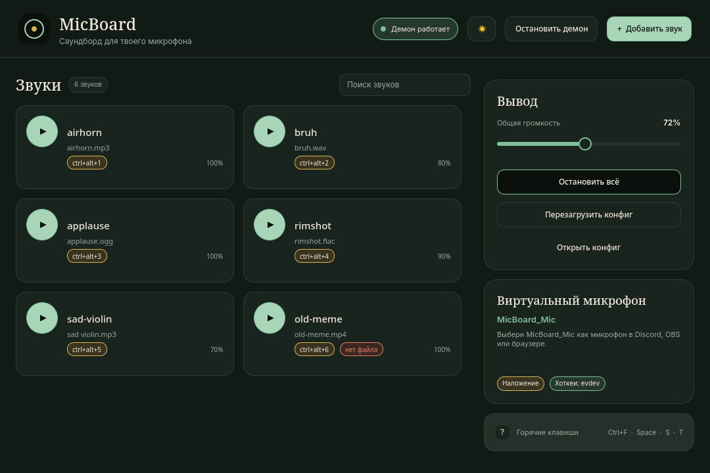

# MicBoard

[](https://github.com/Xoxa-Orig/micboard/actions/workflows/build.yml)
[](LICENSE)

[English version](README.en.md)

Саундборд для микрофона: проигрывает любые медиафайлы прямо в микрофон по глобальным горячим клавишам. Работает на Linux (PipeWire/PulseAudio) и Windows (VB-Audio Virtual Cable).

```
Discord / OBS / браузер  ←  MicBoard_Mic  ←  MicBoard (виртуальный sink)  ←  micboard
```

## Возможности

- Проигрывание **любых** файлов: `mp3`, `wav`, `flac`, `ogg`, `m4a`, а также видео (`mp4`, `mkv`, `webm`, ...) через `ffmpeg`.
- Глобальные горячие клавиши на каждый звук.
- Режимы `overlap` (звуки накладываются) и `exclusive` (новый звук останавливает предыдущий).
- Автоматическое создание виртуального микрофона на Linux.
- Микширование реального микрофона в виртуальный (опционально).
- Локальный control-порт: можно управлять из скриптов, Hyprland, Stream Deck и т.п.
- Автозапуск: systemd user service на Linux, реестр на Windows.
- Окно приложения с карточками звуков, громкостью и перетаскиванием файлов (Qt 6, опционально).
- Один бинарник, без фоновых зависимостей кроме системного аудио.

## Быстрый старт (Linux)

### 1. Зависимости

Arch / Omarchy:

```bash
sudo pacman -S --needed pipewire pipewire-pulse libpulse ffmpeg
```

Debian / Ubuntu:

```bash
sudo apt install pipewire pipewire-pulse pipewire-audio libpulse0 ffmpeg
```

Нужны `pw-cat` (PipeWire) или `paplay` (PulseAudio), а также `pactl`.

### 2. Сборка и установка

```bash
git clone https://github.com/Xoxa-Orig/micboard
cd micboard
cargo build --release
install -Dm755 target/release/micboard ~/.local/bin/micboard
```

Или сразу через Cargo:

```bash
cargo install --git https://github.com/Xoxa-Orig/micboard
```

Требуется Rust 1.85+ (edition 2024).

### 3. Конфигурация

```bash
micboard init          # создаст ~/.config/micboard/config.toml
$EDITOR ~/.config/micboard/config.toml
```

Минимальный пример:

```toml
[[sound]]
id = "airhorn"
file = "~/Music/airhorn.mp3"
hotkey = "ctrl+alt+1"

[[sound]]
id = "bruh"
file = "~/Music/bruh.wav"
hotkey = "ctrl+alt+2"
volume = 0.8
```

### 4. Виртуальный микрофон

```bash
micboard setup
```

Команда создаёт sink `MicBoard` и источник `MicBoard_Mic`. В Discord / OBS / браузере выберите микрофон **MicBoard_Mic**.

Проверить, что всё на месте:

```bash
micboard devices
micboard check
```

### 5. Запуск

```bash
micboard run
```

Теперь горячие клавиши работают, а в другом терминале можно проверить:

```bash
micboard status
micboard play airhorn
micboard stop
```

Чтобы запускать автоматически при входе:

```bash
micboard autostart install
```

## Окно приложения

`micboard-gui` — небольшое окно, из которого можно управлять всем без терминала: карточки звуков, общая громкость, запуск демона и добавление файлов перетаскиванием. Окно не заменяет демон, а управляет им через CLI.

| Светлая тема | Тёмная тема |
| --- | --- |
|  |  |

Сборка и установка (Linux, Qt 6):

```bash
cd gui
./bin/build
./bin/install-local
```

`install-local` кладёт `micboard-gui` в `~/.local/bin`, иконку и `micboard.desktop` в `~/.local/share`. После этого MicBoard открывается из лаунчера приложений, как обычная программа.

Запуск вручную:

```bash
micboard-gui
```

Что умеет окно:

- карточки всех звуков, клик по карточке — проиграть; если демон выключен, он запустится сам;
- **Add sound** и перетаскивание файлов добавляют `[[sound]]` в конфиг;
- удаление звука (× на карточке) с подтверждением;
- поиск по имени, файлу и хоткею (`Ctrl+F`), счётчик найденного;
- светлая и тёмная темы: кнопка ☾/☀ или `T`; при первом запуске режим берётся из активной темы Omarchy;
- общая громкость, **Stop all**, **Reload config**, **Open config**;
- запуск и остановка демона;
- горячие клавиши: `Ctrl+F` — поиск, `Space` — проиграть выбранный, `S` — стоп, `R` — reload, `A` — добавить, `T` — тема, `Q` — выход, `?` — справка.

Окно следует языку Omarchy (`~/.config/omarchy/language`), а если он ещё не выбран — локали системы. Сейчас есть русский и английский.

Для Arch есть `gui/pkgbuild/PKGBUILD`:

```bash
cd gui
./bin/install
```

Нужны `qt6-base`, `qt6-declarative`, `qt6-wayland`, `xdg-desktop-portal` и `pipewire`.

## Горячие клавиши

Формат: `ctrl+alt+1`, `meta+shift+s`, `f9`, `ctrl+space` и т.п. Поддерживаются модификаторы `ctrl`, `alt`, `shift`, `meta`/`super` и клавиши `a-z`, `0-9`, `f1-f24`, стрелки, `space`, `enter`, `tab`, `home`, `end`, `insert`, `delete`, `pageup`, `pagedown`, `-`, `=`, `[`, `]`, `\`, `;`, `'`, `` ` ``, `,`, `.`, `/`, numpad и медиа-клавиши.

### Вариант A: evdev (Wayland, рекомендуемый)

Читает `/dev/input` напрямую и работает в любом окружении, включая Wayland.

```bash
sudo usermod -aG input $USER
# затем выйдите из сессии и войдите снова
```

После повторного входа `micboard run` зарегистрирует хоткеи сам.

### Вариант B: Hyprland binds (без прав)

Если не хочется добавлять пользователя в группу `input`, можно повесить вызовы на сам Hyprland:

```bash
micboard hyprland-binds >> ~/.config/hypr/micboard.conf
```

В `~/.config/hypr/hyprland.conf` добавьте:

```ini
source = ~/.config/hypr/micboard.conf
```

В конфиге MicBoard установите:

```toml
hotkeys = "off"
```

Демон всё равно должен быть запущен (`micboard run` или `micboard autostart install`) — он держит виртуальный микрофон и control-порт.

### Вариант C: native (X11)

На X11 используется библиотека `global-hotkey`. Настройка не требуется, backend выбирается автоматически при `hotkeys = "auto"`.

## Windows

1. Установите [VB-Audio Virtual Cable](https://vb-audio.com/Cable/).
2. Соберите `micboard.exe` (см. ниже) или скачайте готовый [архив из Releases](https://github.com/Xoxa-Orig/micboard/releases).
3. В конфиге укажите выходное устройство:

   ```toml
   device = "CABLE Input"
   ```

   Точное имя покажет `micboard devices`.

4. В Discord / OBS / браузере выберите микрофон **CABLE Output**.
5. Запустите:

   ```powershell
   .\micboard.exe init
   .\micboard.exe run
   ```

Горячие клавиши работают через `global-hotkey` (Win32 `RegisterHotKey`). Для автозапуска:

```powershell
.\micboard.exe autostart install
```

### Сборка под Windows

Из Linux можно проверить сборку без линковки:

```bash
rustup target add x86_64-pc-windows-gnu
cargo check --target x86_64-pc-windows-gnu
```

Полноценный `.exe` собирается в GitHub Actions (workflow `.github/workflows/build.yml`) или на самой Windows:

```powershell
cargo build --release
```

## Конфигурация

Файл по умолчанию: `~/.config/micboard/config.toml` (Linux) или `%APPDATA%\micboard\config.toml` (Windows). Путь можно переопределить через `--config` или переменную `MICBOARD_CONFIG`.

| Параметр | По умолчанию | Описание |
| --- | --- | --- |
| `device` | системный по умолчанию | Sink/устройство вывода. На Linux при включённом `virtual_mic` по умолчанию используется `MicBoard`. |
| `master_volume` | `1.0` | Общая громкость, `0.0 .. 4.0`. |
| `latency_ms` | `40` | Задержка вывода в миллисекундах. |
| `mode` | `"overlap"` | `"overlap"` или `"exclusive"`. |
| `stop_all_hotkey` | `"ctrl+alt+s"` | Глобальная клавиша «стоп всё». |
| `hotkeys` | `"auto"` | `"auto"`, `"native"`, `"evdev"` или `"off"`. |
| `port` | `47832` | Локальный TCP-порт управления. |
| `[virtual_mic] enabled` | `true` | Создавать виртуальный микрофон (Linux). |
| `[virtual_mic] sink` | `"MicBoard"` | Имя виртуального sink. |
| `[virtual_mic] source` | `"MicBoard_Mic"` | Имя виртуального источника. |
| `[virtual_mic] mix_source` | — | Реальный микрофон, который микшируется в виртуальный. |

Каждый звук описывается таблицей `[[sound]]`:

| Поле | Обязательно | Описание |
| --- | --- | --- |
| `id` | нет | Идентификатор для `micboard play <id>`. Если не указан, берётся из имени файла. |
| `file` | да | Путь к файлу. Поддерживаются `~` и относительные пути (относительно конфига). |
| `hotkey` | нет | Глобальная комбинация. |
| `volume` | нет | Индивидуальная громкость, по умолчанию `1.0`. |

Пример с реальным микрофоном:

```toml
[virtual_mic]
enabled = true
sink = "MicBoard"
source = "MicBoard_Mic"
mix_source = "alsa_input.usb-My_Microphone-00.mono-fallback"
```

Имя источника можно узнать в `micboard devices`.

После правки конфига:

```bash
micboard reload
```

## Команды

| Команда | Описание |
| --- | --- |
| `micboard run [--no-hotkeys]` | Запустить демон. |
| `micboard play <id\|path> [--volume N] [--device NAME]` | Проиграть звук. Если демон запущен — через него, иначе напрямую. |
| `micboard stop` | Остановить все звуки. |
| `micboard add <file> [--id ID] [--hotkey COMBO] [--volume N]` | Добавить файл в конфиг. |
| `micboard remove <id>` | Удалить звук из конфига. |
| `micboard volume <0.0..4.0>` | Задать и сохранить общую громкость. |
| `micboard list [--json]` | Показать настроенные звуки. |
| `micboard devices` | Показать sink'и и источники. |
| `micboard setup [--remove] [--with-mic SOURCE]` | Создать/удалить виртуальный микрофон. |
| `micboard init [--force]` | Записать конфиг по умолчанию. |
| `micboard check` | Проверить конфиг, аудио и хоткеи. |
| `micboard reload` | Перечитать конфиг в работающем демоне. |
| `micboard status [--json]` | Состояние демона. |
| `micboard quit` | Остановить демон. |
| `micboard hyprland-binds` | Вывести строки `bindd` для Hyprland. |
| `micboard autostart install\|remove\|status` | Управление автозапуском. |

Все команды принимают `--config <PATH>` и `--verbose`. Флаги `--json` у `list` и `status` выдают машиночитаемый вывод — их использует окно `micboard-gui`.

### Control-порт

Демон слушает `127.0.0.1:47832` и понимает построчные команды:

```
play <id|path>
stop
status
list
reload
volume <0.0..4.0>
quit
```

Пример:

```bash
printf 'play airhorn\n' | nc 127.0.0.1 47832
```

## Диагностика

```bash
micboard check
```

Команда проверяет:

- найден ли output-девайс;
- доступны ли `pw-cat` / `paplay` / `ffmpeg`;
- созданы ли виртуальные sink и source;
- корректны ли хоткеи и нет ли дублей;
- входит ли пользователь в группу `input` (для evdev);
- свободен ли control-порт.

Типичные проблемы:

| Симптом | Решение |
| --- | --- |
| `no readable keyboards in /dev/input` | `sudo usermod -aG input $USER`, перелогиниться. Либо `hotkeys = "off"` + `micboard hyprland-binds`. |
| В Discord тишина | Выберите **MicBoard_Mic**, а не `MicBoard`; проверьте `micboard devices`. |
| Видео не играет | Установите `ffmpeg`. |
| `control port ... is in use` | Демон уже запущен. |
| Звук тихий | Поднимите `master_volume` (можно выше `1.0`) или `volume` у звука. |
| Нет виртуального микрофона после перезагрузки | `micboard setup` или включите `micboard autostart install` (демон создаёт его при старте). |

## Сборка из исходников

```bash
cargo build --release
cargo test
cargo clippy --all-targets

cd gui
./bin/build
./bin/test
```

Linux-зависимости для сборки: `pkg-config`, `libasound2-dev` (Debian/Ubuntu) или `alsa-lib` (Arch). Для окна — `qt6-base`, `qt6-declarative`, `qt6-wayland`.

## Лицензия

MIT. См. [LICENSE](LICENSE).
